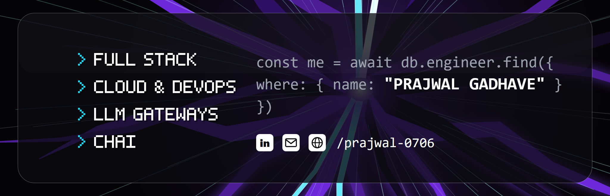
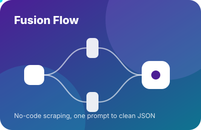

  

## About Me

<h4>
👋 Hi! I am Prajwal, from Pune, India 🇮🇳  
🚀 Founding Engineer at an AI startup, building an LLM gateway and the enterprise security around it  
🧰 Full stack builder who also runs the cluster it ships to  
😎 Portfolio at <a href="https://prajwal-gadhave.vercel.app/">prajwal-gadhave.vercel.app</a>  
☕ Chai over coffee, always
</h4>

## 🌐 Socials

  
  
  
  

## 🚀 Projects

<table>
  <tr>
    <td width="33%"></td>
    <td width="33%"></td>
    <td width="33%"></td>
  </tr>
</table>

## 💻 Tech Stack

  

## 🛠️ Recently Shipped

| Where | What |
|---|---|
| [tscircuit/jlcsearch #614](https://github.com/tscircuit/jlcsearch/pull/614) | Production search returned unrelated parts after every index rebuild. Rekeyed the index so it cannot. |
| [tscircuit/cli #5366](https://github.com/tscircuit/cli/pull/5366) | A 503 told users to fix their profile. Now it tells them what actually failed. |
| [tscircuit/schematic-viewer #292](https://github.com/tscircuit/schematic-viewer/pull/292) | An unused dependency was dragging two security advisories into every consumer. Removed. |

## 🎮 Play Me

One shared board, you are X. Click an empty square, press "Submit new issue" on the page that opens, and this profile plays O within a minute. A draw is the high score.

<!-- ttt:start -->
<table>
    <tr><td align="center"></td><td align="center"></td><td align="center"></td></tr>
    <tr><td align="center"></td><td align="center"></td><td align="center"></td></tr>
    <tr><td align="center"></td><td align="center"></td><td align="center"></td></tr>
</table>

**You played 9, I played 3. Your move, @prajwal-0706.**

Scoreboard: you 0 · me 0 · draws 0 · games 0
<!-- ttt:end -->

## 📊 GitHub Stats

  
  
    
  <picture>
    <source media="(prefers-color-scheme: dark)" srcset="https://raw.githubusercontent.com/prajwal-0706/prajwal-0706/output/github-snake-dark.svg">
    
  </picture>

 

Pune, India · chai over coffee · the best bug report is a failing test

