<picture>
  <source media="(prefers-color-scheme: dark)" srcset="assets/gitlog-dark.svg">
  
</picture>

<b>Prajwal Gadhave</b> · founding engineer in Pune, India · I take things from an empty repo to real users and I like the whole path: the backend, the frontend, the cluster it runs on, the runbook that keeps it up.

## Beat my profile at tic-tac-toe

One shared board for everyone, and you are X. Click an empty square, press "Submit new issue" on the page that opens, and a GitHub Action plays O within a minute, redraws the board and closes the issue. The bot searches the whole game tree, so a draw is the high score.

<!-- ttt:start -->
<table>
    <tr><td align="center"></td><td align="center"></td><td align="center"></td></tr>
    <tr><td align="center"></td><td align="center"></td><td align="center"></td></tr>
    <tr><td align="center"></td><td align="center"></td><td align="center"></td></tr>
</table>

**You played 5, I played 1. Your move, @prajwal-0706.**

Scoreboard: you 0 · me 0 · draws 0 · games 0
<!-- ttt:end -->

## Ship log

| Where | What I fixed | Why it mattered |
|---|---|---|
| [tscircuit/jlcsearch #614](https://github.com/tscircuit/jlcsearch/pull/614) | Search index joined on rowids that changed on every rebuild | Production search returned unrelated parts on every uncached request |
| [tscircuit/cli #5366](https://github.com/tscircuit/cli/pull/5366) | A failed account lookup was reported as a missing handle | A 503 told users to fix their profile instead of retrying |
| [tscircuit/schematic-viewer #292](https://github.com/tscircuit/schematic-viewer/pull/292) | An unused peer dependency dragged in react-router-dom@6 | Two advisories showed up in every consumer's scan |

## Side quests

[**Fusion Flow**](https://github.com/prajwal-0706/fusion-flow), a no-code scraping SaaS with one-prompt AI extraction · [**Lingo**](https://github.com/prajwal-0706/lingo), a language app with AI voice lessons and an XP economy · [**Keep Up**](https://github.com/prajwal-0706/Keep-Up), a real-time notes editor with nested archive and restore

## Puzzles

<picture>
  <source media="(prefers-color-scheme: dark)" srcset="https://leetcard.jacoblin.cool/prajwal_06_?theme=dark&font=Fira%20Code&ext=heatmap">
  
</picture>

## Say hi

Open to part-time contract work and good conversations about backends, clusters and products. [LinkedIn](https://linkedin.com/in/prajwal-gadhave) · [Portfolio](https://prajwal-gadhave.vercel.app/) · prajwalgadhave356@gmail.com

Pune, India · chai over coffee · the best bug report is a failing test

